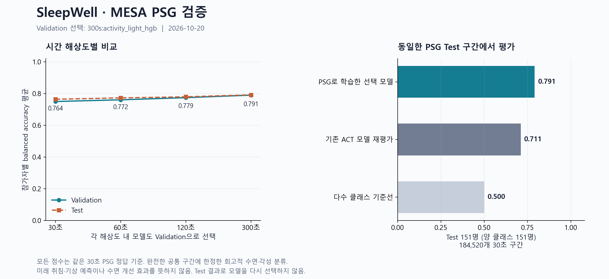

# SleepWell 서윤 담당 검증·추가 작업 보고

2026-10-20 · 작업 루트 `E:\학술제` · 저장소 `SleepWell-integrated`

## 핵심 결과

MESA ACT와 독립 PSG 판독을 연결해 **1,034명**의 연구용 자료를 새로 만들었다. Validation으로 고른 **`300s:activity_light_hgb`**의 Test 참가자별 balanced accuracy(BA)는 **0.7914**다. 같은 PSG Test 구간에 기존 ACT 모델을 적용한 BA는 **0.7110**다.

차이(새 모델 − 기존 ACT 모델)는 **+8.04%p**, 참가자 단위 paired bootstrap 2,000회 95% 구간은 **[+7.14, +8.91]%p**다. 이는 동일 평가 대상의 분류 성능 비교다. 두 모델의 학습 인원과 라벨이 다르므로 차이의 원인을 PSG 라벨 하나로 단정하지 않는다.



## 기존 지시에서 바로잡은 점

- 사용자가 확인한 실제 작업 루트는 T9의 `E:\학술제`이고 담당자는 서윤이다. 최초 `E:\sleepwell` 경로는 정정했다. 앞으로 읽을 수 있도록 루트의 `AGENTS.md`와 `WORKSPACE_CONTEXT.md`에 기록했다.
- PDF는 검증 대상 업무 참고자료로 취급했다. 실제 프로젝트에는 이미 2026-10-10 연구 및 웹 통합 코드가 있어, 처음부터 다시 만드는 대신 기존 결과를 재현 검사하고 가장 큰 근거 공백인 MESA PSG 평가를 추가했다.
- 이전 MESA BA 0.9460은 ACT에서 파생한 `wake` 라벨의 재현 결과다. PSG 정답에서의 정확도나 다음날 수면 예측 점수가 아니다.
- 웹의 S·C·권장 시각은 이미 구현되어 있다. 오래된 “모델 미연결/미래 기능 준비 중” 문서를 실제 코드에 맞게 갱신했다. 현재 부호는 `S+C_sleep`이고, 미래 S는 계속 각성한다는 가정의 경로다.

Google Drive는 백업·팀 공유용으로만 취급했으며 이번 작업에서 업로드·공유·팀원 전송을 하지 않았다. 원자료와 기존 실험 결과도 변경하지 않았다.

## 데이터·정렬 검증

현재 로컬 ACT 파일은 2,159개다. 기존 실험 2,139개와 파일 해시가 모두 일치했고, 20개는 이전 실험에 포함되지 않은 자료다. 이 20개를 이번에 새로 다운로드된 자료라고 추정하지 않는다. 기존 참가자의 Train/Validation/Test 배정 변경은 0건이다.

PSG NSRR XML은 1,157개, 공식 연결표는 1,835명이며, ACT·XML·연결표의 교집합은 1,036명이다. 현재 폴더에서 EDF는 확인되지 않았다. XML 판독으로 수면/각성 정답을 붙일 수 있지만 원 EEG 등 신호를 다시 판독한 검증은 아니다.

공식 연결표의 ACT `line`을 PSG 0번째 30초 epoch로 사용했다. ACT anchor 시각은 연결표 `linetime`과 정확히, XML 시작 시각은 연결표 `starttime_psg`와 정확히 일치해야 한다. 두 시각 사이 최대 15초 반올림 차이는 검사만 하고 위치를 다시 이동시키지 않았다. ACT 행 순서와 30초 간격, XML stage 겹침·지속시간·기록 길이를 검사했다. 날짜 이동 자료를 실제 달력 날짜로 역추정하지 않았다.

[NSRR ACT 문서](https://sleepdata.org/datasets/mesa/pages/actigraphy-introduction.md)와 [동기화 안내](https://sleepdata.org/forum/psg-actigraphy-synchronization-followup/1)가 이 연결 방식을 설명한다. [PSG 자료 설명](https://sleepdata.org/datasets/mesa/pages/polysomnography-introduction.md)은 XML 판독과 EDF 신호를 구분한다. 이 검사는 제공된 anchor에 대한 30초 정렬 검사다. [기기 시계·DST 관련 미해결 논의](https://sleepdata.org/forum/misalignment-between-actigraphy-and-psg)가 있어, 샘플 수준의 절대 동기화를 보장하지 않는다.

| 품질 검사 단계 | 30초 행 수 |
|---|---:|
| XML을 읽은 참가자의 전체 ACT 행 (빈 XML 1명 제외) | 24,338,172 |
| ACT와 겹치는 PSG 채점 행 | 1,308,054 |
| PSG 정답·센서·착용 조건을 통과한 행 | 1,292,802 |
| 모든 해상도가 공유하는 완전 10분 블록 내 행 | 1,272,420 |
| 행 조건 통과 후 블록 완전성 때문에 제외된 행 | 20,382 |

최종 공통 구간은 ACT와 겹치는 PSG 채점 행의 **97.28%**다. 전체 ACT에는 PSG가 없는 여러 날도 포함되므로 전체 ACT 대비 비율을 PSG 품질 비율로 혼동하지 않는다. 이는 비착용·결측·부분 블록을 제외한 조건부 평가다. 완전 구간 요구가 상대적으로 쉬운 구간을 남길 수 있다.

참가자 제외는 **2명**이다. 제외 사유와 인원은 `{"empty_psg_xml": 1, "no_complete_eligible_ten_minute_blocks": 1}`다. 첫 실행은 내용이 0바이트인 XML을 발견해 **학습·Validation·Test 전에 중단**했다. 중단된 폴더는 보존했다. 내용이 있는 1,035개 XML을 모두 점검해 다른 파싱 오류가 없음을 확인한 뒤, 빈 XML을 자료 누락으로 별도 기록하는 사전 검사를 추가하고 새 v2 프로토콜로 실행했다. v2의 허용 제외는 빈 XML 또는 완전한 유효 10분 블록이 전혀 없는 경우이며, 10% 초과 시 학습을 중단한다. 내용 있는 XML의 스키마·시각 정렬·파일 읽기·원본 변경 오류는 조용한 참가자 제외로 바꾸지 않는다. 파생 자료의 SHA256, 원본 해시, 연결표 해시, 코드 해시 및 이전 분할을 기록했다.

## 실험 설계와 결과

| 분할 | 참가자 | 유효 30초 행 |
|---|---:|---:|
| Train | 739 | 909,820 |
| Validation | 144 | 178,080 |
| Test | 151 | 184,520 |

사람별 기존 hash 분할을 유지했다. 이번 PSG 적격 참가자는 모두 이전 ACT 실험에 포함됐던 사람이다. 이전 실험에 없던 ACT 20명은 이번 PSG 적격 집합에 포함되지 않았다. 새롭게 확인한 근거는 같은 참가자의 독립 PSG 판독이며, 새로운 사람 코호트가 아니다.

프로토콜을 먼저 저장하고, 30/60/120/300초 × 4개 후보(다수 클래스 기준선, 활동 Logistic, 활동+조도 Logistic, 활동+조도 HGB 60회)를 고정했다. 모델 및 전처리는 Train만으로 적합했다. Validation의 참가자별 BA로 선택을 저장한 후 Test를 평가했다. 같은 코호트의 ACT Test 결과는 이전에 확인했으므로 외부 코호트 검증이라고 부르지 않는다.

입력은 MESA 원형 활동 및 백색/적색/녹색/청색 조도 채널이다. ACT `wake`, `interval`, PSG stage, 미래 구간은 특징에 포함하지 않았다. 다른 센서의 걸음·가속도·HR을 동일 단위라고 가정해 합치지 않았다. 음수·결측·무한대·비착용을 제외하되 큰 양의 유한 측정값을 임의의 생리적 이상치로 삭제하지 않았다.

30초 PSG의 Wake를 0, 수면 stage 1~5를 1로 사용했다. 알 수 없는 stage나 채점이 없는 시간은 각성으로 채우지 않았다. 긴 epoch의 학습 정답은 다수결이며 동률은 기존 집계 규칙에 따라 수면으로 처리한다. 주 평가는 긴 구간 예측도 같은 원본 30초 정답 위에 투영하므로 해상도마다 쉬워진 정답으로 성능을 부풀리지 않는다. 긴 epoch는 구간 종료 후에 계산할 수 있는 회고적 분류이며 해당 시간만큼 앞선 예측이 아니다.

선택 해상도의 학습 표본은 **90,676행**이다. 사람당 최대 200행·총 200,000행 한도를 적용했다. 모든 유효 행을 전부 학습했다고 표현하면 안 된다. Validation/Test는 공통 유효 구간 전체를 평가했다.

| epoch | 해당 epoch에서 Validation 선택 모델 | Validation BA | Test BA |
|---|---|---:|---:|
| 30s | activity_light_hgb | 0.7495 | 0.7637 |
| 60s | activity_light_hgb | 0.7602 | 0.7722 |
| 120s | activity_light_hgb | 0.7738 | 0.7790 |
| 300s | activity_light_hgb | 0.7896 | 0.7914 |

전체 선택은 **`300s:activity_light_hgb`**다. Test에서 다른 후보가 더 높더라도 선택을 바꾸지 않았다.

선택 모델의 Test 전체 행 기준 accuracy는 0.8172, macro-F1은 0.8071, 각성 특이도는 0.6908, 수면 민감도는 0.9109다. 혼동행렬은 TN=54,285, FP=24,302, FN=9,435, TP=96,498. 참가자별 BA 평균과 전체 행을 합친 BA는 가중 방식이 다르다. BA 평균에는 두 클래스가 모두 있는 151명이 들어간다.

### 고정 후보 전체 결과

| 후보 | Validation BA | Test BA |
|---|---:|---:|
| 30s:activity_light_hgb | 0.7495 | 0.7637 |
| 30s:activity_light_logistic | 0.7218 | 0.7309 |
| 30s:activity_logistic | 0.7011 | 0.7032 |
| 30s:dummy_prior | 0.5000 | 0.5000 |
| 60s:activity_light_hgb | 0.7602 | 0.7722 |
| 60s:activity_light_logistic | 0.7313 | 0.7418 |
| 60s:activity_logistic | 0.7167 | 0.7184 |
| 60s:dummy_prior | 0.5000 | 0.5000 |
| 120s:activity_light_hgb | 0.7738 | 0.7790 |
| 120s:activity_light_logistic | 0.7454 | 0.7552 |
| 120s:activity_logistic | 0.7350 | 0.7370 |
| 120s:dummy_prior | 0.5000 | 0.5000 |
| **300s:activity_light_hgb** | 0.7896 | 0.7914 |
| 300s:activity_light_logistic | 0.7611 | 0.7733 |
| 300s:activity_logistic | 0.7565 | 0.7597 |
| 300s:dummy_prior | 0.5000 | 0.5000 |

전체 지표는 함께 제공한 `MESA_PSG_모델비교_2026-10-20.csv`에도 저장했다. 동일 참가자의 행을 독립 사람처럼 취급하지 않고 참가자를 재표본화한 불확실성 구간을 사용했다. 한 번의 분할·부분 확보 코호트 결과이며 다른 사용자·장치에 대한 일반화를 보장하지 않는다.

## 서윤 담당 항목의 현재 상태

| 항목 | 확인·완료된 작업 | 남아 있는 범위 |
|---|---|---|
| 데이터 통합·품질 | 기존 자료 재현 검사, ACT 전체 해시 대조, 독립 PSG 정답 추가, 사람 분할·원본 보존 | 생리적 입력 단위가 다른 코호트의 무조건 병합은 부적절. 현재 다운로드된 PSG 부분집단의 대표성 검증 필요 |
| 데이터 양·epoch·학습 반복 | 기존 10/10 학습 인원·boosting 반복 비교를 확인. 이번에 PSG 4해상도·16후보 비교 추가 | 이번 PSG 실험의 반복별 곡선·인원 증가 실험은 새로 수행하지 않음 |
| 취침·기상·수면시간 예측 | 기존 한 사람 196일의 시간순 평가와 기준선 비교를 재검증 | 새 다인 일지/당시 입수 시각이 있는 holdout 필요. PSG 동시 분류를 미래 취침 오차로 보고하지 않음 |
| 물리 S·C·propensity | 실제 S+C 정의, τ, 위상, 입력·출력, 조건부 미래 경로를 문서로 확정 | 개인별 τ 식별·물리-only/hybrid의 전향적 비교·추천 효과는 미검증 |
| 앱 인계 | 현재 실행 계약 문서를 수정. MESA 연구 모델·행동 예측·권장 정책 분리 | 웹 계약에 맞는 새 검증 모델 없이 센서 분류 모델을 자동 연결하지 않음 |

기존 개인 취침 MAE 157.5분은 중앙값 기준선과 같고, 기상 MAE 166.82분 대 기준선 176.70분의 개선 구간은 0을 포함했다. 이 기존 결과를 새 MESA 성능으로 대체하지 않는다. NHANES 자기보고 수면시간, CMI 수면 이벤트, MMASH 조건부 자료도 목적과 모집단이 달라 독립적으로 관리한다. 자세한 10/10 결과는 저장소의 `docs/RESEARCH_RESULTS_2026-10-10.md`에 보존되어 있다.

웹에는 별도로 주의할 기존 동작이 있다. 휴대형(portable) 모델이 적용 집단/이력 조건에서 거절되더라도, 본인 과거 자료 연결과 구형 모델 두 개가 있으면 legacy 개발 모델로 fallback한다. 이 경로는 28일 범위·실제 관측 시각 제한을 적용하지 않고 없는 센서 특징을 학습 중앙값으로 대치한다. portable의 검증 규칙을 앱 전체가 항상 만족한다고 표현하면 안 된다. 이번에 입력·출력 문서에 두 경로를 구분했고, 실행 동작은 변경하지 않았다. MESA 모델도 이 legacy 경로에 추가하지 않았다.

## 저장 위치·검증·재현

- 작업 기준: `E:\학술제\AGENTS.md`, `WORKSPACE_CONTEXT.md`.
- 새 코드: `E:\학술제\SleepWell-integrated\tools\model\mesa_psg_alignment.py`, `mesa_psg_experiments.py` 및 두 테스트 파일.
- 현재 모델 계약: `E:\학술제\SleepWell-integrated\docs\interface-schema-모델-입출력.md`.
- 새 파생 자료·모델: `E:\학술제\연구용데이터\mesa_psg_run_20261020_v2`. `mesa_psg_run_20261020`은 빈 XML 때문에 중단된 미완료 자료이며 성능 결과로 사용하지 않는다.
- 원본별 경로·참가자 토큰을 포함한 manifest, NPZ 및 예측 파일은 위 로컬 연구 폴더에 보관한다. 이 공유용 보고서와 그래프는 집계 결과만 포함한다.

연구 도구 테스트 **62/62**, 기존 웹 테스트 **20/20**가 통과했다. 기존 10/10 통합 재현 검사도 통과했다. 새 결과는 전체 1,034개 파생 자료의 해시·분할·유한값·공통 블록 구조와 원본 2,068개 해시를 확인했다. 보존된 PSG 정답 1,272,420개를 XML stage와 다시 대조하고, 두 제외 사유도 재검사했다. Validation 선택 및 모든 Test 후보의 혼동행렬을 재계산했다. 저장된 선택 모델을 Test 151명 전체에 다시 적용한 184,520개 예측의 불일치는 **0건**이었다. 기존 ACT 모델의 같은 구간 성능과 paired bootstrap도 재현했다.

코드 검토에서 평가 전 기존 모델 규격 검사와 오류를 임의 참가자 제외로 처리하는 문제를 수정한 뒤 실제 실험을 실행했다. 원본/이전 결과를 덮어쓰거나 Test 결과로 재튜닝하지 않았다. 기존 pandas 사용 경로의 deprecation 경고는 테스트 실패가 아니며 이번 작업에서 관련 없는 코드를 수정하지 않았다.

실행 환경: Python 3.12.1, NumPy 2.4.1, pandas 3.0.5, scikit-learn 1.8.0. 기존 격리 환경을 사용했고 새 의존성은 설치하지 않았다. native thread는 2개로 제한했다.

재실행은 `E:\학술제`에서 아래처럼 **새 output 경로**를 지정한다. 이미 Test를 확인한 이후의 반복은 새 독립 검증이라고 부르지 않는다.

```powershell
& '연구용데이터/.venv/Scripts/python.exe' -B -X utf8 'SleepWell-integrated/tools/model/mesa_psg_experiments.py' --root 'E:/학술제/데이터셋/MESA' --output 'E:/학술제/연구용데이터/mesa_psg_new_run' --baseline 'E:/학술제/연구용데이터/mesa_run_20261010'
& '연구용데이터/.venv/Scripts/python.exe' -B -X utf8 -m unittest discover -s 'SleepWell-integrated/tools/model' -p 'test_*.py' -q
```
